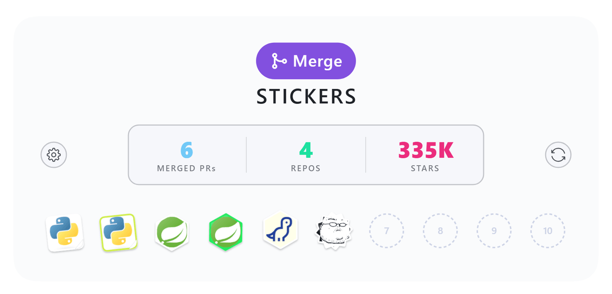

<p align="center">
  <a href="https://github.com/htjworld">
    <picture>
      <source media="(prefers-color-scheme: dark)" srcset="assets/readme/board-dark.png">
      
    </picture>
  </a>
</p>

<h1 align="center">Merge Stickers</h1>

<p align="center">
  <b>Every merged PR deserves a sticker.</b><br>
  Your open-source merges, collected as a sticker board on your GitHub profile. Updated by a GitHub Action. No server, no signup.
</p>

<p align="center">
  <a href="https://github.com/marketplace/actions/merge-stickers"></a>
  <a href="https://github.com/htjworld/merge-stickers/releases"></a>
  <a href="https://github.com/htjworld/merge-stickers/stargazers"></a>
  <a href="LICENSE"></a>
</p>

<p align="center">
  <a href="#install">Install</a> · <a href="#how-stickers-level-up">Tiers</a> · <a href="#settings">Settings</a> · <a href="#private-prs">Private PRs</a> · <a href="#faq">FAQ</a> · <a href="https://github.com/htjworld">Live demo</a>
</p>

---

You fixed a bug in CPython. It got merged. Your contribution graph turned one square slightly greener, and that was it.

Merge Stickers gives that PR a sticker. Each one shows the project's logo and links back to the PR, and the sticker levels up every time you get merged into the same repo again. Once a week a GitHub Action collects your merged PRs and redraws the board in your profile README.

## Install

You need a profile repo: the public repo named after your username (`you/you`). Its README is what GitHub shows on your profile.

**1. Mark the spot.** Add these two lines to the profile README, where the board should go:

```html
<!--MERGE-STICKERS:START-->
<!--MERGE-STICKERS:END-->
```

**2. Add the workflow.** Copy [`templates/workflow.yml`](templates/workflow.yml) to `.github/workflows/merge-stickers.yml` in that repo. That template includes the settings form. The minimal version works too:

```yaml
name: merge-stickers
on:
  schedule:
    - cron: "0 18 * * 0" # weekly
  workflow_dispatch:
permissions:
  contents: write
jobs:
  build:
    runs-on: ubuntu-latest
    steps:
      - uses: actions/checkout@v4
      - uses: htjworld/merge-stickers@v1
```

**3. Run it.** Open **Actions → merge-stickers → Run workflow**. In about 30 seconds your board is on your profile.

That's it. No token to create, no secret to add: for public PRs the built-in `GITHUB_TOKEN` is enough.

<details>
<summary><b>Prefer the terminal?</b> One command does all three steps.</summary>

<br>

Inside your profile repo, with Node 20+ and the [GitHub CLI](https://cli.github.com) signed in (`gh auth login`):

```sh
npx github:htjworld/merge-stickers init
```

It creates the workflow, a commented `.merge-stickers/config.yml`, the README markers, and a `CLAUDE.md` plus a `/curate` command for Claude Code. Then it draws your first board. Commit and push.

</details>

## How stickers level up

<p align="center">
  
</p>

<p align="center">
  <sub><b>1st</b> white · <b>2nd</b> color · <b>10th</b> bronze · <b>20th</b> silver · <b>30th</b> gold · <b>40th</b> platinum · <b>50th</b> diamond</sub>
</p>

A sticker's tier is how many times you had been merged into that repo when the PR landed. Your first PR into a project is a plain white sticker. Your 50th is diamond. Metal tiers shine.

What makes it onto the board:

- **Merged PRs you authored, in repos you don't own.** Your own repos are left out by default (`include.own: true` brings them in).
- **Your whole history,** not just what happened after you installed it.
- **The project's own picture.** The first image in its README, then its social preview, then the owner's avatar.
- **Stable looks.** Shape, tilt and finish come from the repo name, so a sticker never reshuffles between runs.

## Settings

The board carries two buttons. They are visible to everyone, but only you can use them.

| Button | Opens |
|---|---|
| ⚙ settings | `.merge-stickers/config.yml` in the GitHub editor |
| ⟳ fetch | **Run workflow**, with a form for the common options |

Everything lives in one commented file, [`.merge-stickers/config.yml`](templates/config.yml). The settings you'll most likely touch:

| Key | Default | What it does |
|---|---|---|
| `visibility` | `public` | `public`, `private` or `all` PRs |
| `private.display` | `mask` | Private PRs as a lock sticker with the name removed, or `hide`, or `show` |
| `exclude.repos` | `[]` | Skip repos, globs allowed: `["my-company/*"]` |
| `exclude.prs` | `[]` | Skip single PRs: `["owner/repo#123"]` |
| `layout.groupBy` | `pr` | One sticker per PR, or `repo` for one per repo with an ×N badge |
| `layout.columns` | `10` | Stickers per row |
| `theme` | `paper` | `paper`, `holo`, `midnight` or `minimal` |
| `sticker.thresholds` | 10 / 20 / 30 / 40 / 50 | PRs needed for bronze → diamond |
| `header.stat` | `stars` | Third header number: `stars`, `since`, `latest` or `owners` |
| `stickers."owner/repo"` | | Override one repo's (or one PR's) `shape`, `finish`, `tier`, `color`, `image`, `rotate` or `hidden` |

Your editor gets autocomplete and validation from the [JSON Schema](schema/merge-stickers.schema.json) referenced at the top of the file.

## Private PRs

Work PRs count too, if you want them to. Without a token they are never fetched.

1. [Create a classic token with the `repo` scope](https://github.com/settings/tokens/new?scopes=repo&description=merge-stickers).
2. Add it to your profile repo as a secret named `GH_PAT` (`gh secret set GH_PAT`). The workflow template already passes it along.
3. Set `visibility: all` and run the workflow.

Private PRs appear as lock stickers with no repo or PR name, and every run ends with a `check` that fails if a private name would leak into the README or images. If your company uses SAML SSO, authorize the token for that organization, or its PRs stay invisible.

## Commands

The Action runs these for you. Locally they run as `npx github:htjworld/merge-stickers <command>`.

| Command | What it does |
|---|---|
| `init` | Sets up a profile repo and draws the first board. Add `--all` to include private PRs. |
| `fetch` | Collects your merged PRs into `.merge-stickers/merges.json`. Needs a token (`GH_TOKEN` or `gh auth login`). |
| `render` | Redraws the board from saved data. No network, so tweaking config is instant. |
| `check` | Fails on a private name leak, an oversized board or an unknown config key. |
| `set key=value …` | Edits config.yml from the command line, keeping its comments. This is how the Run workflow form saves your choices. |

## FAQ

**Does it count PRs I got merged before installing it?**
Yes. The first run collects your entire history.

**A repo got renamed or deleted. Is my sticker gone?**
No. Stickers are tracked by PR id, so renames follow along and vanished repos keep their sticker.

**Can I reach diamond by sending 50 typo fixes to one repo?**
Technically. The maintainers will remember you.

**Will it slow down my profile?**
Stickers are small SVGs with the logo embedded, so there are no extra requests to third-party sites.

**Does it work in dark mode?**
Every piece ships in a light and a dark version, and GitHub picks the right one.

**Why stickers?**
A green square never made anyone want to open a second PR.

## License

[MIT](LICENSE). Icons in the board buttons are [Octicons](https://github.com/primer/octicons) (MIT); see [THIRD_PARTY_NOTICES.md](THIRD_PARTY_NOTICES.md).
